# Technical Design Document (TDD): Schedovyn Landing Page

| Informasi Dokumen | Detail |
|---|---|
| **Nama Proyek** | Schedovyn Landing Page (Marketing & Product Showcase Web) |
| **Produk Induk** | Schedovyn (*Smart Timetable Planner*) |
| **Versi Dokumen** | 1.0.0 |
| **Dokumen Referensi** | [docs/Schedovyn-Landing-Page-PRD.md](Schedovyn-Landing-Page-PRD.md), [DESIGN.md](../DESIGN.md), [AGENTS.md](../AGENTS.md) |
| **Tech Stack Utama** | Astro (`output: "static"`), React 19 Islands, TypeScript (`strict`), Tailwind CSS v4 (`radix-lyra`), Vitest |
| **Package Manager** | `pnpm` (Node.js `>=22.23.4`) |
| **Status** | Siap Untuk Eksekusi Siklus TDD (Fase RED & GREEN) |

---

## 1. Gambaran Umum Arsitektur & Strategi Rendering

**Schedovyn Landing Page** dirancang menggunakan arsitektur **Astro Static Site Generation (SSG)** yang dipadukan dengan **Astro Islands (React 19)**. Pendekatan ini memastikan seluruh konten informasi pemasaran, struktur SEO, dan ilustrasi antarmuka dirender menjadi HTML + CSS statis murni (`0 KB JS`), sementara komponen demonstrasi interaktif dihidrasi secara selektif di sisi klien.

### 1.1 Diagram Arsitektur Komponen & Hidrasi

```mermaid
flowchart TD
    subgraph BuildTime["Astro Static Build (0 KB Client JS)"]
        BL["BaseLayout.astro (SEO, OpenGraph, JSON-LD, Anti-FOUC Script)"]
        IDX["pages/index.astro"]
        NAV["layout/Navbar.astro (FR-LP-01)"]
        HERO["sections/HeroSection.astro (FR-LP-02)"]
        TB["sections/TrustBar.astro (FR-LP-02)"]
        PS["sections/ProblemSolutionSection.astro (FR-LP-03)"]
        FBG["sections/FeatureBentoGrid.astro (FR-LP-05)"]
        HIW["sections/HowItWorksSection.astro (FR-LP-07)"]
        PRIV["sections/PrivacyArchitectureSection.astro (FR-LP-08)"]
        BCTA["sections/BottomCtaSection.astro (FR-LP-10)"]
        FOOT["layout/Footer.astro (FR-LP-10)"]
    end

    subgraph ClientIslands["Astro Islands (React 19 Selective Hydration)"]
        TT["layout/ThemeToggle.tsx (client:load)"]
        CPI["islands/ConflictPlaygroundIsland.tsx (client:visible) (FR-LP-04)"]
        EST["islands/ExportShowcaseTabsIsland.tsx (client:visible) (FR-LP-06)"]
        FAQ["islands/FaqAccordionIsland.tsx (client:visible) (FR-LP-09)"]
    end

    subgraph DataLayer["Typed Data Contracts (src/data/*.ts)"]
        SC["site-config.ts"]
        FEAT["features.ts"]
        SIM["simulation-scenarios.ts"]
        FAQS["faqs.ts"]
    end

    BL --> IDX
    IDX --> NAV
    NAV --> TT
    IDX --> HERO
    HERO --> TB
    IDX --> PS
    IDX --> CPI
    IDX --> FBG
    IDX --> EST
    IDX --> HIW
    IDX --> PRIV
    IDX --> FAQ
    IDX --> BCTA
    IDX --> FOOT

    SC --> NAV
    SC --> HERO
    SC --> PS
    SC --> HIW
    SC --> PRIV
    SC --> BCTA
    SC --> FOOT
    FEAT --> FBG
    FEAT --> EST
    SIM --> CPI
    FAQS --> FAQ
```



### 1.2 Matriks Anggaran Hidrasi (*Hydration Budget Matrix* - `NFR-LP-01`)

Untuk memenuhi syarat **total JavaScript initial load `< 40 kB` (gzip)** dan **FCP `< 0.8 detik`**, penggunaan direktif hidrasi Astro dibatasi secara ketat sebagai berikut:

| Komponen | Jenis Berkas | Direktif Hidrasi | Alasan Teknis |
|---|---|---|---|
| `Navbar.astro` | Astro Component | Statis (`0 KB JS`) | Navigasi jangkar HTML murni dan tautan CTA |
| `ThemeToggle.tsx` | React 19 Island | `client:load` | Harus segera merespons klik sakelar tema dan pintasan tombol `D` sejak halaman dimuat |
| `HeroSection.astro` & `TrustBar.astro` | Astro Component | Statis (`0 KB JS`) | Menjamin *Largest Contentful Paint (LCP)* instan pada 5 detik pertama kunjungan |
| `ProblemSolutionSection.astro` | Astro Component | Statis (`0 KB JS`) | Tabel/kartu komparasi statis |
| `ConflictPlaygroundIsland.tsx` | React 19 Island | `client:visible` | Dihidrasi hanya saat pengunjung menggulir mendekati seksi `#simulasi` |
| `FeatureBentoGrid.astro` | Astro Component | Statis (`0 KB JS`) | Kartu fitur *Bento Grid* dirender penuh pada waktu *build* |
| `ExportShowcaseTabsIsland.tsx` | React 19 Island | `client:visible` | Dihidrasi saat pengunjung mencapai seksi `#ekspor` |
| `HowItWorksSection.astro` | Astro Component | Statis (`0 KB JS`) | Daftar 4 langkah terstruktur |
| `PrivacyArchitectureSection.astro` | Astro Component | Statis (`0 KB JS`) | Blok informasi arsitektur IndexedDB lokal |
| `FaqAccordionIsland.tsx` | React 19 Island | `client:visible` | Dihidrasi saat pengunjung mencapai seksi `#faq` |
| `BottomCtaSection.astro` & `Footer.astro` | Astro Component | Statis (`0 KB JS`) | Banner konversi akhir dan tautan *footer* |

---

## 2. Konfigurasi Proyek, Lingkungan, & Dependensi (`pnpm`)

### 2.1 Daftar Paket yang Diperlukan (`package.json`)
Seluruh instalasi wajib dijalankan menggunakan `pnpm`:
- **Dependencies:**
  - `astro`
  - `@astrojs/react`, `react`, `react-dom`
  - `@astrojs/sitemap`
  - `@tailwindcss/vite`, `tailwindcss`
  - `lucide-react`
  - `clsx`, `tailwind-merge`
  - `@fontsource-variable/figtree`, `@fontsource-variable/inter`
- **DevDependencies:**
  - `typescript`, `@types/react`, `@types/react-dom`
  - `vitest`, `@testing-library/react`, `@testing-library/jest-dom`, `@testing-library/user-event`, `jsdom`

### 2.2 Skrip Standar `package.json`
```json
{
  "scripts": {
    "dev": "astro dev",
    "build": "astro build",
    "preview": "astro preview",
    "test": "vitest run",
    "test:watch": "vitest",
    "astro": "astro"
  }
}
```

### 2.3 Konfigurasi Variabel Lingkungan (`PUBLIC_*`)
Variabel lingkungan dibaca melalui `import.meta.env` dengan nilai *fallback* aman di `src/data/site-config.ts`:
- `PUBLIC_APP_URL`: Default `https://app.schedovyn.com`
- `PUBLIC_GUIDE_URL`: Default `https://guide.schedovyn.com`
- `PUBLIC_SITE_URL`: Default `https://schedovyn.com` (digunakan oleh `@astrojs/sitemap` dan canonical URL)

---

## 3. Kontrak Data & Skema TypeScript (`src/data/`)

Seluruh berkas di `src/data/` wajib mematuhi **Zero `any` Policy** (`strict: true`) dan **Bebas Karakter *Em Dash* (`—`)**.

### 3.1 `src/data/site-config.ts`
Menyimpan konfigurasi URL lintas proyek, item navigasi jangkar (`FR-LP-01`), poin *Trust Bar* (`FR-LP-02`), komparasi Masalah vs Solusi (`FR-LP-03`), 4 langkah cara kerja (`FR-LP-07`), dan poin privasi lokal (`FR-LP-08`).

```ts
export interface NavAnchorItem {
  readonly id: string;
  readonly label: string;
  readonly href: `#${string}`;
}

export interface TrustBarItem {
  readonly id: string;
  readonly label: string;
  readonly iconName: 'shield-check' | 'zap' | 'file-spreadsheet' | 'wifi-off';
}

export interface ProblemSolutionItem {
  readonly id: string;
  readonly dimension: string;
  readonly oldWay: string;
  readonly schedovynWay: string;
  readonly metricBadge?: string;
}

export interface WorkflowStepItem {
  readonly stepNumber: '01' | '02' | '03' | '04';
  readonly title: string;
  readonly description: string;
  readonly highlightTag: string;
}

export interface SiteConfig {
  readonly brandName: 'Schedovyn';
  readonly tagline: 'Smart Timetable Planner';
  readonly versionBadge: 'v1.0 Local-First';
  readonly appUrl: string;
  readonly guideUrl: string;
  readonly siteUrl: string;
  readonly navAnchors: readonly NavAnchorItem[];
  readonly trustBarItems: readonly TrustBarItem[];
  readonly problemSolutions: readonly ProblemSolutionItem[];
  readonly workflowSteps: readonly WorkflowStepItem[];
}
```

**Nilai Wajib `navAnchors` (`FR-LP-01`):**
1. `{ id: 'fitur', label: 'Fitur Utama', href: '#fitur' }`
2. `{ id: 'cara-kerja', label: 'Cara Kerja', href: '#cara-kerja' }`
3. `{ id: 'simulasi', label: 'Simulasi Konflik', href: '#simulasi' }`
4. `{ id: 'ekspor', label: 'Ekspor & Laporan', href: '#ekspor' }`
5. `{ id: 'faq', label: 'Tanya Jawab', href: '#faq' }`

**Nilai Wajib `trustBarItems` (`FR-LP-02`):**
1. `100% Client-Side & Privasi Lokal`
2. `Deteksi 7 Jenis Konflik Real-Time`
3. `Ekspor PDF Cetak & Excel Rekap Guru`
4. `Mendukung Mode Offline (PWA)`

---

### 3.2 `src/data/simulation-scenarios.ts` (`FR-LP-04` & `AC-LP-03`)
Mendefinisikan model data untuk **Astro Island Simulasi Interaktif Deteksi Konflik** (`ConflictPlaygroundIsland.tsx`).

```ts
export type ValidationStatusCode =
  | 'CONFLICT_DETECTED'
  | 'INCOMPLETE'
  | 'NO_CONFLICT_CURRENT_DATA'
  | 'COMPLETE_AND_VALID';

export type ConflictScenarioId =
  | 'TEACHER_OVERLAP'
  | 'SEQUENTIAL_NO_CONFLICT'
  | 'BREAK_TIME_OVERLAP'
  | 'INSTANT_RESOLUTION';

export interface SimulatedSessionBlock {
  readonly id: string;
  readonly className: 'Kelas VII-A' | 'Kelas VIII-A';
  readonly subject: string;
  readonly teacher: string;
  readonly room: string;
  readonly startTime: string; // Format HH:mm, wajib tabular-nums (misal: "08:00")
  readonly endTime: string;   // Format HH:mm, wajib tabular-nums (misal: "09:00")
  readonly isConflicting: boolean;
  readonly conflictCode?: 'TEACHER_OVERLAP' | 'BREAK_TIME_OVERLAP';
}

export interface SimulationScenario {
  readonly id: ConflictScenarioId;
  readonly shortLabel: string;
  readonly title: string;
  readonly description: string;
  readonly validationStatus: ValidationStatusCode;
  readonly statusLabel:
    | 'Konflik Ditemukan'
    | 'Belum Lengkap'
    | 'Tidak Ada Konflik pada Data Saat Ini'
    | 'Jadwal Lengkap dan Valid';
  readonly scanTimeLabel: string; // Contoh: "< 5 ms"
  readonly breakInterval: {
    readonly startTime: string; // Contoh: "09:15"
    readonly endTime: string;   // Contoh: "09:30"
    readonly label: string;     // Contoh: "Istirahat Pagi (09:15 - 09:30)"
  };
  readonly sessions: readonly SimulatedSessionBlock[];
  readonly diagnosticMessage: string;
  readonly resolutionHint: string;
}
```

**Spesifikasi 4 Skenario Wajib (`SIMULATION_SCENARIOS`):**
1. **`TEACHER_OVERLAP` (Skenario 1: Bentrokan Guru Lintas Kelas):**
   - `validationStatus`: `'CONFLICT_DETECTED'`, `statusLabel`: `'Konflik Ditemukan'`.
   - Sesi: Pak Budi mengajar Matematika di **Kelas VII-A** (`08:00 - 09:00`) dan ditempatkan mengajar Matematika di **Kelas VIII-A** (`08:30 - 09:30`).
   - Kedua blok sesi memiliki `isConflicting: true` dan `conflictCode: 'TEACHER_OVERLAP'`.
   - `diagnosticMessage`: Menjelaskan bahwa Pak Budi mengalami irisan waktu mengajar pada rentang `08:30 - 09:00` antara Kelas VII-A dan Kelas VIII-A.
2. **`SEQUENTIAL_NO_CONFLICT` (Skenario 2: Sesi Berurutan Presisi `08:00 - 09:00` & `09:00 - 10:00`):**
   - `validationStatus`: `'NO_CONFLICT_CURRENT_DATA'`, `statusLabel`: `'Tidak Ada Konflik pada Data Saat Ini'`.
   - Sesi: Pak Budi mengajar di **Kelas VII-A** (`08:00 - 09:00`) dan langsung mengajar di **Kelas VIII-A** (`09:00 - 10:00`).
   - Seluruh blok sesi memiliki `isConflicting: false`.
   - `diagnosticMessage`: Membuktikan bahwa batas waktu akhir `09:00` dan waktu mulai `09:00` dihitung secara presisi menggunakan perbandingan interval setengah terbuka (`[start, end)`), sehingga sesi berurutan **tidak** dianggap bertabrakan.
3. **`BREAK_TIME_OVERLAP` (Skenario 3: Irisan Waktu Istirahat):**
   - `validationStatus`: `'CONFLICT_DETECTED'`, `statusLabel`: `'Konflik Ditemukan'`.
   - Sesi: Sesi Bahasa Indonesia di **Kelas VIII-A** (`08:45 - 09:45`) memotong jam istirahat sekolah (`09:15 - 09:30`).
   - Blok sesi memiliki `isConflicting: true` dan `conflictCode: 'BREAK_TIME_OVERLAP'`.
4. **`INSTANT_RESOLUTION` (Skenario 4: Resolusi Konflik Instan):**
   - `validationStatus`: `'COMPLETE_AND_VALID'`, `statusLabel`: `'Jadwal Lengkap dan Valid'`.
   - Sesi: Seluruh sesi pada **Kelas VII-A** (`07:00 - 08:00`, `08:00 - 09:00`) dan **Kelas VIII-A** (`07:00 - 08:00`, `08:00 - 09:00`) telah digeser ke slot bebas bentrokan dengan guru dan ruangan yang valid.
   - Seluruh blok sesi memiliki `isConflicting: false`.

---

### 3.3 `src/data/features.ts` (`FR-LP-05` & `FR-LP-06`)
Mendefinisikan 6 kartu fitur *Bento Grid* (`FEATURE_BENTO_ITEMS`) dan data pratinjau ekspor (`EXPORT_SHOWCASE_TABS`).

```ts
export interface FeatureBentoItem {
  readonly id: string;
  readonly codeRange: string; // Contoh: "FR-01 & FR-02"
  readonly title: string;
  readonly description: string;
  readonly colSpan: 'normal' | 'wide';
  readonly highlights: readonly string[];
  readonly badgeText: string;
}

export type ExportTabId = 'pdf-landscape' | 'excel-multi-sheet';

export interface ExcelWorksheetSpec {
  readonly sheetName: 'Jadwal' | 'Rekap Guru' | 'Rekap Ruangan' | 'Konflik';
  readonly purpose: string;
  readonly columns: readonly string[];
  readonly sampleRow: readonly string[];
}

export interface ExportShowcaseTab {
  readonly id: ExportTabId;
  readonly tabLabel: string;
  readonly badge: string;
  readonly title: string;
  readonly description: string;
  readonly securityAndFormatNotes: readonly string[];
  readonly excelWorksheets?: readonly ExcelWorksheetSpec[];
}
```

**Daftar 6 Kartu Wajib `FEATURE_BENTO_ITEMS` (`FR-LP-05`):**
1. **Konfigurasi Jam Belajar Fleksibel:** Hari aktif (5 atau 6 hari), jam pulang Jumat lebih awal, multi-periode istirahat, dan interval *snap grid* (`15`, `30`, `45`, atau `60` menit).
2. **Manajemen Data Master & Ketersediaan:** Kelas, Mata Pelajaran dengan 10 palet warna kontras tinggi (WCAG AA), Guru beserta *unavailable intervals*, dan Ruangan Khusus (Lab IPA, Lab Komputer, Lapangan).
3. **Penyalinan Jadwal Kelas Paralel:** Duplikasi jadwal dari Kelas VII-A ke VII-B sekali klik dengan 3 strategi guru/ruangan (*Gunakan Guru Default Kelas Tujuan*, *Salin Guru Sumber*, atau *Kosongkan*).
4. **Riwayat Perubahan 50 Langkah (Undo & Redo):** Eksperimen bebas dengan pintasan `Ctrl+Z` dan `Ctrl+Y`.
5. **Penyimpanan Lokal Jujur & Tangguh:** Auto-save ke IndexedDB peramban tanpa tombol simpan manual, lengkap dengan diagnostik kapasitas penyimpanan.
6. **Aksesibilitas Keyboard Penuh:** Geser waktu sesi dengan `Alt + Panah` atau tempatkan sesi langsung dari panel melalui kontrol formulir tanpa bergantung pada *mouse drag*.

---

### 3.4 `src/data/faqs.ts` (`FR-LP-09`)
Mendefinisikan 6 pertanyaan dan jawaban FAQ untuk `FaqAccordionIsland.tsx`.

```ts
export interface FaqItem {
  readonly id: string;
  readonly question: string;
  readonly answer: string;
  readonly category: 'Privasi & Biaya' | 'Mode Offline' | 'Penjadwalan' | 'Penyimpanan Data';
}
```

**Daftar 6 Pertanyaan Wajib (`FAQ_ITEMS`):**
1. `Apakah Schedovyn benar-benar gratis dan tanpa perlu membuat akun?`
2. `Apakah aplikasi ini bisa digunakan saat koneksi internet sekolah mati?`
3. `Bagaimana jika satu guru mengajar di banyak kelas dan memiliki hari libur khusus (misal guru tidak hadir hari Selasa)?`
4. `Apakah saya bisa memindahkan jadwal kelas yang mirip tanpa menyusun ulang dari awal?`
5. `Di mana data jadwal saya disimpan dan bagaimana cara mengamankannya?`
6. `Mengapa jadwal tetap diizinkan ditempatkan ke grid meskipun berkonflik?` (Wajib memuat penjelasan konsep *Non-Blocking Placement* agar penyuntingan jadwal tetap luwes).

---

## 4. Spesifikasi Teknis Komponen & Interaksi

### 4.1 `src/layouts/BaseLayout.astro`
- **Atribut HTML:** `<html lang="id" class="scroll-smooth">`
- **Skrip Anti-FOUC Tema (Inline `<script is:inline>` di dalam `<head>`):**
  - Membaca `localStorage.getItem('schedovyn-theme')`.
  - Jika bernilai `'dark'` atau belum disetel namun `window.matchMedia('(prefers-color-scheme: dark)').matches` bernilai `true`, tambahkan kelas `'dark'` pada `document.documentElement` sebelum *first paint*.
- **Metadata SEO & JSON-LD (`SoftwareApplication`):**
  - Title, meta description, canonical URL, OpenGraph (`og:title`, `og:description`, `og:image` mengarah ke `/og-cover.png`, `og:type="website"`), serta `<script type="application/ld+json">` untuk `SoftwareApplication` (`applicationCategory: "EducationalApplication"`, `operatingSystem: "Web Browser (Client-Side PWA)"`, `offers.price: "0"`).

### 4.2 `src/components/layout/ThemeToggle.tsx` (`client:load`, `AC-LP-05`)
- **State:** `theme: 'light' | 'dark'`.
- **Interaksi Klik:** Mengubah state tema, memperbarui `document.documentElement.classList.toggle('dark', nextTheme === 'dark')`, dan menyimpan ke `localStorage.setItem('schedovyn-theme', nextTheme)`.
- **Pintasan Keyboard `D`:**
  - Mendaftarkan `window.addEventListener('keydown', handler)`.
  - Jika `event.key === 'd' || event.key === 'D'`, tanpa modifier `ctrlKey`, `metaKey`, atau `altKey`, dan elemen fokus aktif (`document.activeElement`) **bukan** `INPUT`, `TEXTAREA`, `SELECT`, atau `isContentEditable`, maka tema berganti secara instan.
- **Aksesibilitas:** Memiliki `aria-label` yang jelas (misal: `"Ganti tema terang atau gelap (Pintasan: D)"`) dan menampilkan indikator tombol `D`.

### 4.3 `src/components/islands/ConflictPlaygroundIsland.tsx` (`client:visible`, `FR-LP-04`, `AC-LP-03`)
- **Props:** `{ initialScenarioId?: ConflictScenarioId }` (default: `'TEACHER_OVERLAP'`).
- **Fitur Interaktif:**
  1. **Pemilih 4 Skenario (`role="tablist"`):** Tombol untuk memilih `TEACHER_OVERLAP`, `SEQUENTIAL_NO_CONFLICT`, `BREAK_TIME_OVERLAP`, atau `INSTANT_RESOLUTION`.
  2. **Tombol Aksi Cepat Resolusi:** Saat berada pada skenario konflik (`TEACHER_OVERLAP` atau `BREAK_TIME_OVERLAP`), menyediakan tombol interaktif **"Selesaikan Konflik Otomatis"** (atau **"Geser ke Jam Kosong"**) yang langsung memindahkan state ke `'INSTANT_RESOLUTION'`.
  3. **Header Status Validasi Real-Time:** Menampilkan lencana status sesuai warna semantik (`CONFLICT_DETECTED` = merah/destructive, `NO_CONFLICT_CURRENT_DATA` = biru langit/sky, `COMPLETE_AND_VALID` = hijau zamrud/emerald) serta metrik kecepatan pindai `< 5 ms` (`tabular-nums`).
  4. **Mini-Kanvas 2 Baris Kelas:** Merender baris **Kelas VII-A** dan **Kelas VIII-A** pada rentang waktu Senin `07:00 - 10:00` beserta penanda zona **Istirahat Pagi (`09:15 - 09:30`)** dan kartu sesi pelajaran (`tabular-nums`).
  5. **Panel Diagnostik Konflik:** Menampilkan kode konflik (`TEACHER_OVERLAP` / `BREAK_TIME_OVERLAP`), pesan penjelasan dalam Bahasa Indonesia, dan panduan resolusi.

### 4.4 `src/components/islands/ExportShowcaseTabsIsland.tsx` (`client:visible`, `FR-LP-06`, `AC-LP-04`)
- **State:** `activeTab: ExportTabId` (default: `'pdf-landscape'`), serta `activeSheet: 'Jadwal' | 'Rekap Guru' | 'Rekap Ruangan' | 'Konflik'` saat berada di tab Excel.
- **Tab 1 (`pdf-landscape`):** Menampilkan replika visual dokumen **PDF Cetak Landscape** berbingkai teknis `1px`, lengkap dengan header sekolah contoh, lencana status validasi, matriks jadwal mingguan (`tabular-nums`), dan blok catatan konflik di bagian bawah.
- **Tab 2 (`excel-multi-sheet`):** Menampilkan replika visual *workbook* **Excel (`.xlsx`) Multi-Worksheet** dengan pemilih 4 tab lembar kerja di bagian bawah (`Jadwal`, `Rekap Guru`, `Rekap Ruangan`, `Konflik`), indikator *AutoFilter* aktif, dan badge keamanan **Sanitasi Formula Aktif**.

### 4.5 `src/components/islands/FaqAccordionIsland.tsx` (`client:visible`, `FR-LP-09`)
- Merender 6 item tanya jawab dari `src/data/faqs.ts`.
- Menggunakan elemen `<button aria-expanded={isOpen} aria-controls={panelId}>` yang dapat dioperasikan penuh dengan keyboard (`Tab`, `Enter`, `Space`) sesuai `NFR-LP-03`.
- Secara default membuka item pertama atau mengizinkan pengguna membuka/menutup setiap pertanyaan secara mandiri.

---

## 5. Matriks Pengujian Otomatis (TDD Test Suite - `src/__tests__/`)

Seluruh pengujian dijalankan menggunakan **Vitest** dan **`@testing-library/react`**:

| Berkas Test | Target Pengujian | Cakupan Persyaratan |
|---|---|---|
| `src/__tests__/data-contracts.spec.ts` | Validasi kelengkapan `site-config.ts`, `features.ts` (6 kartu Bento), `simulation-scenarios.ts` (4 skenario), `faqs.ts` (6 FAQ termasuk *Non-Blocking Placement*), serta URL `PUBLIC_APP_URL` & `PUBLIC_GUIDE_URL`. | `FR-LP-01` s.d. `FR-LP-10`, `AC-LP-02`, `AC-LP-06` |
| `src/__tests__/no-em-dash.spec.ts` | Memindai seluruh berkas di `src/` (`*.ts`, `*.tsx`, `*.astro`, `*.css`) untuk memastikan **0 kemunculan karakter *em dash* (`—` / `\u2014`)**. | `AC-LP-05`, Bagian 4.4 PRD |
| `src/__tests__/theme-toggle.test.tsx` | Menguji klik tombol `ThemeToggle`, perubahan kelas `.dark` pada `document.documentElement`, penyimpanan `localStorage`, pintasan keyboard `D`, dan pengabaian pintasan `D` saat fokus berada di dalam `<input>` / `<textarea>`. | `FR-LP-01`, `AC-LP-05`, `NFR-LP-03` |
| `src/__tests__/conflict-playground.test.tsx` | Menguji `ConflictPlaygroundIsland`: tampilan awal `TEACHER_OVERLAP` (indikator merah & penjelasan Pak Budi), perpindahan ke `SEQUENTIAL_NO_CONFLICT` (`08:00 - 09:00` & `09:00 - 10:00` bebas konflik), `BREAK_TIME_OVERLAP`, dan resolusi instan ke `COMPLETE_AND_VALID`. | `FR-LP-04`, `AC-LP-03`, `NFR-LP-03` |
| `src/__tests__/export-showcase-tabs.test.tsx` | Menguji `ExportShowcaseTabsIsland`: perpindahan antara Tab PDF Landscape dan Tab Excel (`.xlsx`), serta visibilitas ke-4 lembar kerja (`Jadwal`, `Rekap Guru`, `Rekap Ruangan`, `Konflik`). | `FR-LP-06`, `AC-LP-04`, `NFR-LP-03` |
| `src/__tests__/faq-accordion.test.tsx` | Menguji `FaqAccordionIsland`: merender 6 pertanyaan umum, interaksi klik dan keyboard (`aria-expanded`), serta keberadaan penjelasan *Non-Blocking Placement*. | `FR-LP-09`, `NFR-LP-03` |

---

## 6. Urutan Eksekusi Implementasi (TDD Roadmap)

1. **Langkah 1 - Persiapan Infrastruktur & Test Runner:**
   - Konfigurasi dependensi `pnpm` (React 19, Tailwind CSS v4, Vitest, Testing Library, Lucide, Fontsource).
   - Konfigurasi `astro.config.mjs`, `tsconfig.json`, dan `vitest.config.ts`.
2. **Langkah 2 - Fase RED (QA Engineer):**
   - Menulis seluruh berkas pengujian di `src/__tests__/` berdasarkan kontrak pada Bab 3, 4, dan 5 dokumen ini.
   - Memverifikasi bahwa `pnpm run test` gagal (*RED*) karena modul data dan komponen belum diimplementasikan.
3. **Langkah 3 - Fase GREEN: Data Layer & Design Tokens (Frontend Engineer):**
   - Mengimplementasikan `src/styles/global.css` sesuai spesifikasi token warna OKLCH di [DESIGN.md](../DESIGN.md).
   - Mengimplementasikan `src/data/site-config.ts`, `src/data/simulation-scenarios.ts`, `src/data/features.ts`, dan `src/data/faqs.ts`.
   - Mengimplementasikan komponen primitif `radix-lyra` di `src/components/ui/`.
4. **Langkah 4 - Fase GREEN: Astro Islands Interaktif (Frontend Engineer):**
   - Mengimplementasikan `ThemeToggle.tsx`, `ConflictPlaygroundIsland.tsx`, `ExportShowcaseTabsIsland.tsx`, dan `FaqAccordionIsland.tsx`.
5. **Langkah 5 - Fase GREEN: Layout & Seksi Statis Astro (Frontend Engineer):**
   - Mengimplementasikan `BaseLayout.astro`, `Navbar.astro`, `Footer.astro`, ke-7 seksi statis di `src/components/sections/*.astro`, aset publik (`public/favico.svg`, `public/og-cover.png`, `public/robots.txt`), serta merakit `src/pages/index.astro`.
6. **Langkah 6 - Verifikasi Akhir & Sinkronisasi Codegraph (QA & Frontend Engineer):**
   - Menjalankan `pnpm run test` (seluruh test wajib **PASS / GREEN**).
   - Menjalankan `pnpm run build` (`astro build` wajib menghasilkan `dist/` dengan `0` error TypeScript).
   - Menjalankan `codegraph sync`.
