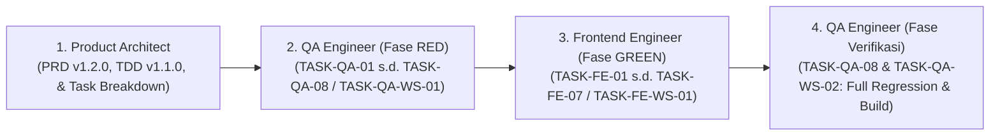

# Peta Eksekusi TDD (Master Roadmap): Schedovyn Landing Page

| Informasi Dokumen | Detail |
|---|---|
| **Proyek** | Schedovyn Landing Page (Marketing & Product Showcase Web) |
| **Acuan Utama** | [docs/Schedovyn-PRD.md](../Schedovyn-PRD.md) (v1.1.0), [docs/Schedovyn-Landing-Page-PRD.md](../Schedovyn-Landing-Page-PRD.md) (v1.2.0), [docs/Schedovyn-Landing-Page-TDD.md](../Schedovyn-Landing-Page-TDD.md) (v1.1.0), [DESIGN.md](../../DESIGN.md) |
| **Metode Pengembangan** | Test-Driven Development (RED -> GREEN -> REFACTOR) |
| **Package Manager** | `pnpm` (Wajib untuk seluruh instalasi dan eksekusi skrip) |

---

## 1. Alur Kolaborasi Agen (TDD Lifecycle)

1. **Fase 1 - Spesifikasi Pengujian / RED ([01-qa-engineer-tasks.md](01-qa-engineer-tasks.md)):**
   - **QA Engineer** menyiapkan dan memperbarui berkas pengujian Vitest + React Testing Library di `src/__tests__/` (termasuk **`TASK-QA-WS-01`** untuk fitur terbaru **Pengelolaan Multi-Ruang Kerja / Multi-Workspace `FR-13` & `AC-LP-07`**).
   - Pengujian untuk fitur baru pada tahap ini **wajib gagal (RED)** terlebih dahulu karena kontrak data (`src/data/*.ts`) dan komponen (`src/components/**`) belum diperbarui ke spesifikasi `FR-13`.
   - Setelah selesai menulis/memperbarui test, QA Engineer menjalankan `codegraph sync` dan menyerahkan eksekusi ke Frontend Engineer.
2. **Fase 2 - Implementasi Produk / GREEN ([02-frontend-engineer-tasks.md](02-frontend-engineer-tasks.md)):**
   - **Frontend Engineer** mengimplementasikan pembaruan lapisan data (`src/data/site-config.ts`, `src/data/features.ts` 7 kartu Bento termasuk `FR-13`, `src/data/faqs.ts` 7 item FAQ), komponen Island (`FaqAccordionIsland.tsx`), serta seksi statis Astro (`HeroSection.astro` dengan *Workspace Switcher*, `FeatureBentoGrid.astro` dengan ikon `Layers`, `HowItWorksSection.astro`, dan `PrivacyArchitectureSection.astro`) sesuai **`TASK-FE-WS-01`**.
   - Frontend Engineer wajib memastikan seluruh test unit/komponen berstatus **PASS (GREEN)** (`pnpm run test`) dan kompilasi statis (`pnpm run build`) berhasil tanpa error TypeScript.
3. **Fase 3 - Verifikasi Akhir & Quality Gate ([01-qa-engineer-tasks.md](01-qa-engineer-tasks.md#task-qa-08-verifikasi-akhir-integrasi-build-statis--regresi-fase-green)):**
   - **QA Engineer** menjalankan verifikasi menyeluruh (`TASK-QA-08` & `TASK-QA-WS-02`) atas hasil build statis di `dist/`, memastikan seluruh kriteria penerimaan `AC-LP-01` s.d. `AC-LP-07`, persyaratan fungsional `FR-LP-01` s.d. `FR-LP-10`, dan persyaratan non-fungsional `NFR-LP-01` s.d. `NFR-LP-04` terpenuhi 100%.

---

## 2. Daftar Dokumen Task

| Berkas Task | Agen Penanggung Jawab | Ringkasan Cakupan |
|---|---|---|
| **[docs/tasks/01-qa-engineer-tasks.md](01-qa-engineer-tasks.md)** | `[Schedovyn - Landing Page] Quality Assurance (QA) Engineer` | `TASK-QA-01` s.d. `TASK-QA-08` & Delta Multi-Workspace (`TASK-QA-WS-01`, `TASK-QA-WS-02`): Test kontrak data 7 kartu Bento (`FR-13`) & 7 FAQ, audit bebas *em dash*, test 4 Astro Islands, test struktur seksi `.astro` (*Workspace Switcher* & isolasi IndexedDB), serta verifikasi build `dist/`. |
| **[docs/tasks/02-frontend-engineer-tasks.md](02-frontend-engineer-tasks.md)** | `[Schedovyn - Landing Page] Frontend Engineer` | `TASK-FE-01` s.d. `TASK-FE-07` & Delta Multi-Workspace (`TASK-FE-WS-01` s.d. `TASK-FE-WS-03`): Implementasi data `FR-13` di `src/data/*.ts`, pembaruan `FaqAccordionIsland.tsx` (7 FAQ), pembaruan `HeroSection.astro`, `FeatureBentoGrid.astro`, `HowItWorksSection.astro`, dan `PrivacyArchitectureSection.astro`. |

---

## 3. Matriks Keterlacakan Persyaratan (Requirement Traceability Matrix)

| ID Persyaratan | Deskripsi Singkat | Task Frontend Engineer | Task QA Engineer |
|---|---|---|---|
| **FR-LP-01** | Header & Navigasi Sticky (`Navbar.astro` + `ThemeToggle.tsx`) | `TASK-FE-04`, `TASK-FE-05` | `TASK-QA-02`, `TASK-QA-04`, `TASK-QA-08` |
| **FR-LP-02** | Hero Section, *Trust Bar*, & *Hero Mockup* 3 Panel Editor + *Workspace Switcher* | `TASK-FE-02`, `TASK-FE-06`, `TASK-FE-WS-02` | `TASK-QA-02`, `TASK-QA-08`, `TASK-QA-WS-01` |
| **FR-LP-03** | Seksi Masalah vs Solusi (`< 5 ms`, 4 Status Validasi) | `TASK-FE-02`, `TASK-FE-06` | `TASK-QA-02`, `TASK-QA-08` |
| **FR-LP-04** | Astro Island Simulasi Interaktif Deteksi Konflik (4 Skenario) | `TASK-FE-02`, `TASK-FE-04` | `TASK-QA-02`, `TASK-QA-05` |
| **FR-LP-05** | Sorotan Fitur Lengkap dalam *Bento Grid* (7 Kartu Kemampuan: `FR-01` s.d. `FR-13` & PWA) | `TASK-FE-02`, `TASK-FE-06`, `TASK-FE-WS-01`, `TASK-FE-WS-02` | `TASK-QA-02`, `TASK-QA-08`, `TASK-QA-WS-01` |
| **FR-LP-06** | Astro Island Pameran Hasil Ekspor (PDF Landscape vs Excel 4 Sheet) | `TASK-FE-02`, `TASK-FE-04` | `TASK-QA-02`, `TASK-QA-06` |
| **FR-LP-07** | Seksi Alur Kerja 4 Langkah (`HowItWorksSection.astro` - Langkah 1 Persiapan/Kloning Workspace) | `TASK-FE-02`, `TASK-FE-06`, `TASK-FE-WS-01` | `TASK-QA-02`, `TASK-QA-08`, `TASK-QA-WS-01` |
| **FR-LP-08** | Seksi Arsitektur Privasi, Multi-Workspace Terisolasi & Auto-Restore IndexedDB | `TASK-FE-02`, `TASK-FE-06`, `TASK-FE-WS-02` | `TASK-QA-02`, `TASK-QA-08`, `TASK-QA-WS-01` |
| **FR-LP-09** | Astro Island Pertanyaan Umum 7 Poin (`FaqAccordionIsland.tsx` termasuk `FR-13` Multi-Workspace) | `TASK-FE-02`, `TASK-FE-04`, `TASK-FE-WS-01`, `TASK-FE-WS-02` | `TASK-QA-02`, `TASK-QA-07`, `TASK-QA-WS-01` |
| **FR-LP-10** | Banner Penutup (`BottomCtaSection.astro`) & `Footer.astro` | `TASK-FE-05`, `TASK-FE-06` | `TASK-QA-08` |
| **AC-LP-01 & NFR-LP-01** | Kompilasi `pnpm run build` ke `dist/` (0 error TS, `< 40 kB` gzip JS) | `TASK-FE-01`, `TASK-FE-07`, `TASK-FE-WS-03` | `TASK-QA-08`, `TASK-QA-WS-02` |
| **AC-LP-02 & AC-LP-06** | Tautan CTA `PUBLIC_APP_URL` & `PUBLIC_GUIDE_URL` di Header, Hero, & Footer | `TASK-FE-02`, `TASK-FE-05`, `TASK-FE-06` | `TASK-QA-02`, `TASK-QA-08` |
| **AC-LP-03** | Pembuktian `TEACHER_OVERLAP` merah & Sesi Berurutan (`08:00 - 09:00` & `09:00 - 10:00`) bebas konflik | `TASK-FE-02`, `TASK-FE-04` | `TASK-QA-05` |
| **AC-LP-04** | Perpindahan Tab PDF Landscape vs Tab Excel 4 Worksheet | `TASK-FE-02`, `TASK-FE-04` | `TASK-QA-06` |
| **AC-LP-05** | Tema Terang/Gelap + pintasan `D`, desain `radix-lyra` (`rounded-none`, `tabular-nums`), & bebas *em dash* | `TASK-FE-01` s.d. `TASK-FE-07`, `TASK-FE-WS-03` | `TASK-QA-03`, `TASK-QA-04`, `TASK-QA-08`, `TASK-QA-WS-02` |
| **AC-LP-07** | Representasi Fitur Multi-Ruang Kerja (`FR-13`) di Hero Mockup, Bento Grid, How It Works, Privasi, & FAQ | `TASK-FE-WS-01`, `TASK-FE-WS-02`, `TASK-FE-WS-03` | `TASK-QA-WS-01`, `TASK-QA-WS-02` |
| **NFR-LP-02, 03, 04** | Responsif `360px` s.d. `1440px+`, Aksesibilitas Keyboard WCAG AA, *Zero External Tracking* | `TASK-FE-04` s.d. `TASK-FE-07` | `TASK-QA-04` s.d. `TASK-QA-08` |
